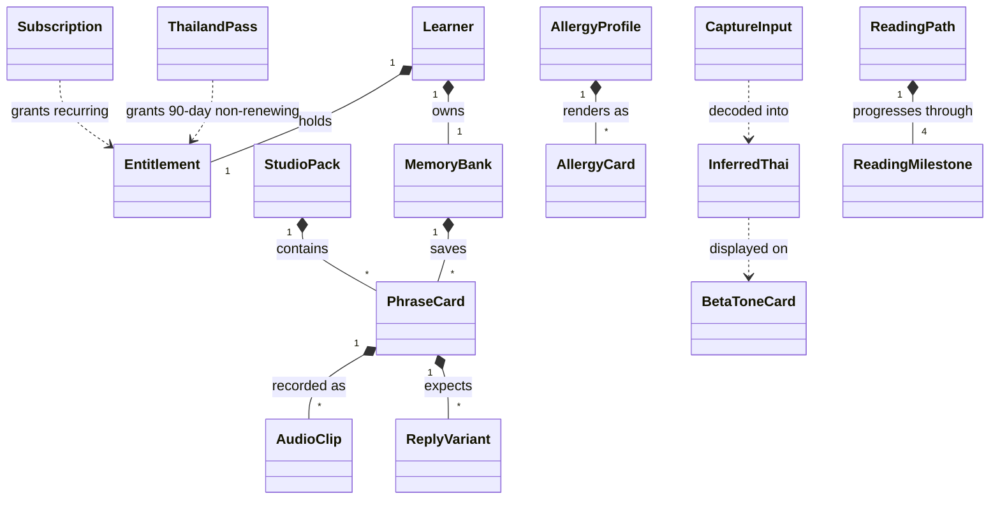

# StreetThai

StreetThai domain terms are canonical everywhere: code, docs, Linear issues, tests, and commit messages.

## Relationships

## Learners & Access

**Learner**:
An English-speaking long-stay visitor or traveler in Thailand using StreetThai.
_Avoid_: user, student, customer

**Entitlement**:
The **Learner**'s current access state (Free, or paid via a **Thailand Pass** or **Subscription**), including any active **Offline Allowance** window.
_Avoid_: plan, license, tier

**Thailand Pass**:
A one-time, tax-inclusive, non-renewing 90-day purchase that grants paid **Entitlement** and stacks on remaining days when extended early.
_Avoid_: 90-day subscription, pass renewal

**Subscription**:
A recurring monthly or yearly plan that grants paid **Entitlement**, with an optional 7-day no-card trial.
_Avoid_: pass

**Offline Allowance**:
The bounded post-expiry window (7 days) during which an offline device retains paid **Entitlement** before requiring online revalidation.
_Avoid_: buffer, cache window, offline grace

## Curated Content & Safety

**Studio Pack**:
A curated, TFL-audited thematic collection of **Phrase Cards** and **Reply Variants** with dual-gender studio **Audio Clips**.
_Avoid_: course, module, deck

**Phrase Card**:
One curated street-Thai expression with audited Thai script, canonical **Sound Spelling**, visual tone markers, and polite particle pairing (`kráp`/`kâ`/`ká`).
_Avoid_: flashcard, lesson card, item

**Reply Variant**:
A realistic spoken reply a Thai vendor or local may give to a **Phrase Card**, trained for ear recognition.
_Avoid_: response, answer

**Audio Clip**:
A studio-recorded spoken clip (male or female voice, plus Chiang Mai `jâo` variants) paired to a **Phrase Card** or **Reply Variant**.
_Avoid_: recording, sound, TTS

**Allergy Profile**:
A **Learner**'s selected food allergies and dietary restrictions used to assemble **Allergy Cards**.
_Avoid_: diet settings, food preferences

**Allergy Card**:
A free-forever, offline-ready Thai safety card assembled strictly from audited allergy slots so a vendor can read it with zero mistranslation.
_Avoid_: food card, translation card

**Memory Bank**:
A **Learner**'s personal saved collection of **Phrase Cards** and captured expressions synced offline-first.
_Avoid_: favorites, bookmarks, saved list

## Phonetics, Decoding & Script

**Sound Spelling**:
The canonical phonetic transcription system used across all StreetThai content (42 living consonants, vowel length, offglides, and exact tone diacritics), derived from Paiboon conventions.
_Avoid_: romanization, transliteration, RTGS, Paiboon+

**Capture Input**:
Ad-hoc Thai text or speech a **Learner** pastes or captures outside curated **Studio Packs**.
_Avoid_: lookup, query

**Inferred Thai**:
Thai inferred at runtime from **Capture Input**, distinct from audited **Studio Pack** copy.
_Avoid_: decoded Thai, translated Thai, raw output

**Beta Tone Card**:
The dedicated UI surface that renders **Inferred Thai** with explicit visual tone markings and beta provenance signaling.
_Avoid_: decoded card, preview card

**Reading Path**:
The progressive 4-stage orthographic path (`Speak First` -> `Class-Batch Consonants` -> `Tone-Colored Script` -> `Native Reader`).
_Avoid_: script bridge, alphabet course, reading mode

**Reading Milestone**:
One of the four milestones along the **Reading Path**.
_Avoid_: script stage, level, step

## Design Process

**Design Prototype**:
A high-fidelity screen or flow design built in Paper, using real-app reference screens from Mobbin as input, to validate UI before it is implemented.
_Avoid_: mockup, wireframe, paper prototype, Figma file
