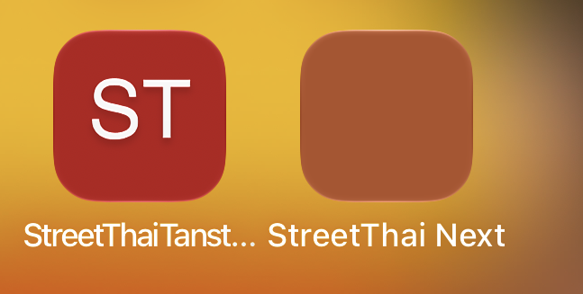

# TanStack Start is the frontend framework for `apps/web`

StreetThai builds its one PWA in `apps/web/` on TanStack Start (Vite + Nitro, Vercel preset pinned to `fra1`), not Next.js, because its static preset produces the Phase 2 Capacitor bundle without config changes and its toolchain passes TS 7 and OXLint untouched. The [TOM-7](https://linear.app/tomasz-goral/issue/TOM-7) spike built the same throwaway app against `@streetthai/db` in Next.js 16.4.6 ([TOM-13](https://linear.app/tomasz-goral/issue/TOM-13)) and TanStack Start ([TOM-14](https://linear.app/tomasz-goral/issue/TOM-14)), checked both on a real iPhone ([TOM-15](https://linear.app/tomasz-goral/issue/TOM-15)), and scored them on the TOM-7 weighted criteria. The handoff comments on those issues hold the per-criterion evidence; no spike code was merged.

## TanStack Start wins 39 to 37 on the weighted score

Neither framework scored 0 on a Hard Gate (C1-C4), so the Non-Gates decide: TanStack Start's static preset (C6) and clean toolchain pass (C5) outweigh Next.js's single-declaration prerender (C1).

| ID | Criterion (weight) | Next.js | TanStack Start |
| -- | -- | -- | -- |
| C1 | Static SEO prerendering (x2) | 3 | 2 |
| C2 | Offline PWA shell + iOS A2HS (x3) | 2 | 2 |
| C3 | `@streetthai/db` reactivity + client boundary (x3) | 3 | 3 |
| C4 | Vercel `fra1` route + streaming (x2) | 2 | 2 |
| C5 | Monorepo toolchain, TS 7 + OXLint (x2) | 2 | 3 |
| C6 | Capacitor static bundle (x2) | 2 | 3 |
| C7 | Solo-builder DX + build speed (x2) | 2 | 2 |
| | **Weighted total (max 48)** | **37** | **39** |

The result holds under both debatable readings. If both C2 scores were read as 1, because both apps relied on custom precache entries (Next.js `additionalPrecacheEntries`, TanStack Start `manifestTransforms`), TanStack Start still wins 36 to 34. If TanStack Start's C5 were read as 2, the totals tie at 37 and the TOM-7 R3 tie-break goes to TanStack Start.

## Both apps worked offline on a real iPhone, but the Next.js icon was blank

Installed with Add to Home Screen in standalone mode and run in Airplane Mode, both apps handled `/` to `/dishes/pad-kra-pao` and back, a reload, and the `kráp`/`kâ` toggle. The Next.js home-screen icon rendered as a blank tile, which counts against its C2 friction but is not a gate failure.



## Next.js was rejected on static bundling and config friction

Next.js's `output: "export"` fails while an API route exists, so a Capacitor build needs a file-rename convention and a second `pageExtensions` env mode that silently drops the rewrites and headers the service worker depends on (C6). Its type-check depends on running `next typegen` and including the generated `.next/types` (C5). Its PWA path also hid more behavior: the default `reloadOnOnline` broke offline navigation and RSC payloads are not precached. Revisit this choice only if TanStack Start or its PWA plugin develops a Hard Gate blocker in `apps/web`.

## Consequences

- **PWA plugin precache bug:** `@vite-pwa/tanstack@0.0.5` maps a nested `a/b/index.html` to precache URL `a`, so the service worker installs but never activates. `apps/web` ([TOM-8](https://linear.app/tomasz-goral/issue/TOM-8)) carries this `generateSW.manifestTransforms` entry under a `// PLATFORM: @vite-pwa/tanstack@0.0.5` comment and drops it after a fixed release:

  ```ts
  manifestTransforms: [
    async (entries) => ({
      manifest: entries.map((entry) => ({
        ...entry,
        url: entry.url.replace(/^(.+)\/index\.html$/, "$1"),
      })),
      warnings: [],
    }),
  ],
  ```

- **Undocumented PWA setup:** `apps/web` also needs `ssr.noExternal: ["@vite-pwa/tanstack"]` (without it prerender renders 0 routes), `magicast` and `@unplugin-pwa/core` as direct devDependencies, and `includeManifestIcons: false`.
- **Double prerender declaration:** list each prerendered route in both Nitro `routeRules` (`prerender: true`) and `tanstackStart({ prerender, pages })`, so prerender runs twice per build.
- **Pre-1.0 dependencies:** Nitro v3 is an RC and `@vite-pwa/tanstack` is 0.0.5, so pin exact versions through the pnpm catalog and upgrade deliberately.
- **Capacitor API calls:** server routes such as `/api/health` 404 in the static build, so a Phase 2 Capacitor shell must call the deployed `fra1` API by absolute URL; the spike did not test this.
